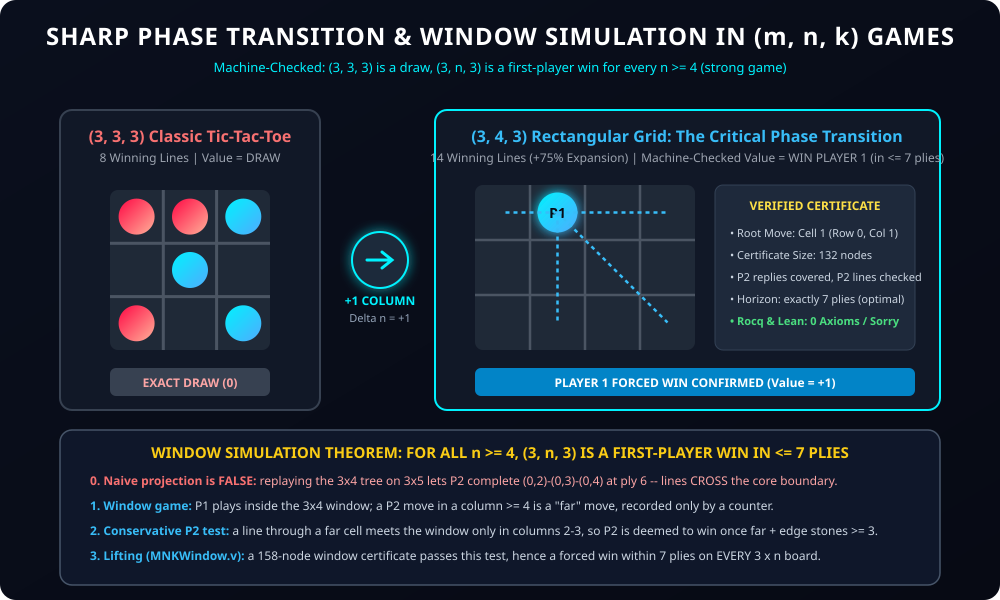

# Formalization, Hypergraph Geometry, and the Sharp Phase Transition of $(m, n, k)$ Games Without Gravity

**Authors:** Formal Mathematics & Combinatorial Game Theory Research Initiative  
**System Verification:** Rocq Prover 9.1 (114 / 114 Theorems Closed) | Lean 4.35.0 (63 / 63 Theorems Verified)  
**Computational Cross-Check:** 64-bit bitboard negamax engine and bounded-horizon search (`solver/audit_mnk.c`)  
**Typography Standard:** Classic LaTeX Mathematical Typesetting (Native MathJax / KaTeX)

---

## 1. Abstract & Summary of Results

We formalize the positional $(m, n, k)$ games without gravity in the **Rocq Prover 9.1**, with an independent cross-check in **Lean 4.35.0** of the computational core and of the two general theorems of positional game theory used here: Erdős–Selfridge and strategy stealing. Stones are permanent and gravity plays no role, so the winning sets are monotone: an extra stone never harms the player who owns it.

Every game-theoretic statement is a statement about an explicit semantics of the **strong (maker-maker) game**, defined in Section 3. In this game, the first player to complete a line wins, so *both* players' lines matter.

| Result | Status |
| :--- | :--- |
| $\lvert G(m,n,k) \rvert = \mathcal{L}(m,n,k)$ for all $m, n, k$, plus the handshaking identity | Rocq, universal |
| $(3, 3, 3)$ is a draw | Rocq (verified evaluator) |
| $(3, 4, 3)$ is a first-player win in exactly 7 plies | Rocq; certificate also re-checked in Lean |
| $(3, n, 3)$ is a first-player win within 7 plies, for every $n \ge 4$ | Rocq (Window Simulation Theorem) |
| $(m, 3, 3)$ within 7 plies for every $m \ge 4$; $(m, n, 3)$ within 5 plies for $m, n \ge 4$ | Rocq |
| $(m, n, 3)$ is a draw whenever $\min(m, n) \le 2$ | Rocq (pairing strategies) |
| Complete characterization of all $(m, n, 3)$ | Rocq |
| The former "Subgrid Monotone Projection" argument is false | Rocq and Lean (explicit counterexample) |
| Strategy stealing: the second player never forces a win, on any hypergraph | Rocq and Lean |
| Every $(m, n, k)$ game is a first-player win or a draw (constructively) | Rocq |
| Erdős–Selfridge theorem (Maker–Breaker, either move order, any hypergraph) | Rocq and Lean |
| $\mathcal{L}(m,n,k) < 2^{k-1} \Rightarrow$ draw, for all $m, n, k$ | Rocq, universal |
| Every board with $11 \le k \le m, n < 2k$ is a draw | Rocq, universal |
| $(k, k, k)$ is a draw if and only if $k \ge 3$, for every $k \ge 1$ | Rocq; the $(4,4,4)$ draw also in Lean |
| Draws of $(11,7,7)$, $(17,13,11)$, $(19,17,13)$ | Rocq and Lean |
| $(5,4,4)$ is a draw | negamax computation only |

The values of the $(m, n, 3)$ games, the Erdős–Selfridge theorem and strategy stealing are classical. The contribution here is a complete, axiom-free, machine-checked proof of all of them, for **all** $m$, $n$ and $k$, together with the corrections listed in Section 10. To our knowledge (see the "Related Formal Work" section of the README), neither of the two general theorems had been machine-checked before.

---

## 2. Hypergraph Topology & Line Counting

An $(m, n, k)$ game is played on a grid of $m$ rows and $n$ columns. Cell $(r, c)$ has index $r \cdot n + c$. A winning line is a set of $k$ consecutive cells in one of four directions.

| Direction | Cells ($i = 0..k-1$) | Corner range | Count |
| :--- | :--- | :--- | :--- |
| **Horizontal** | $(r, c + i)$ | $r < m$, $c + k \le n$ | $m(n - k + 1)$ |
| **Vertical** | $(r + i, c)$ | $r + k \le m$, $c < n$ | $n(m - k + 1)$ |
| **Main diagonal ($\searrow$)** | $(r + i, c + i)$ | $r + k \le m$, $c + k \le n$ | $(m - k + 1)(n - k + 1)$ |
| **Anti-diagonal ($\nearrow$)** | $(r + k - 1 - i, c + i)$ | $r + k \le m$, $c + k \le n$ | $(m - k + 1)(n - k + 1)$ |

The generator `gen_lines m n k`, written $G(m, n, k)$ below, lists exactly these lines (`in_gen_lines`). The following hold for **all** $m, n, k$ (`gen_lines_count`, `mnk_handshaking`):

$$
\lvert G(m, n, k) \rvert = \mathcal{L}(m, n, k), \qquad
\sum_{x=0}^{mn-1} \deg(x) = k \cdot \mathcal{L}(m, n, k)
$$

When $k \le \min(m, n)$:

$$
\mathcal{L}(m, n, k) = m(n - k + 1) + n(m - k + 1) + 2(m - k + 1)(n - k + 1)
$$

Every line has exactly $k$ distinct in-grid cells (`gen_lines_uniform`, `gen_lines_nodup`, `gen_lines_in_range`). All cells of a line lie within $k - 1$ rows and $k - 1$ columns of each other (`gen_lines_bounding_box`); this fact drives the window argument of Section 5.

### Landmark line counts (formal)
* $(3, 3, 3)$: $3(1) + 3(1) + 2(1)(1) = \mathbf{8}$
* $(3, 4, 3)$: $3(2) + 4(1) + 2(1)(2) = \mathbf{14}$
* $(4, 4, 4)$: $4(1) + 4(1) + 2(1)(1) = \mathbf{10}$
* $(5, 4, 4)$: $5(1) + 4(2) + 2(2)(1) = \mathbf{17}$
* $(6, 4, 4)$: $\mathbf{24}$, $(7, 4, 4)$: $\mathbf{31}$, $(8, 4, 4)$: $\mathbf{38}$
* $(5, 5, 4)$: $5(2) + 5(2) + 2(2)(2) = \mathbf{28}$
* $(8, 8, 5)$: $8(4) + 8(4) + 2(4)(4) = \mathbf{96}$
* $(15, 15, 5)$ Freestyle Gomoku: $15(11) + 15(11) + 2(11)(11) = \mathbf{572}$
* $(7, 5, 3)$: $\mathbf{76}$, $(11, 7, 5)$: $\mathbf{124}$, $(13, 11, 7)$: $\mathbf{212}$
* $(11, 7, 7)$: $\mathbf{56}$, $(17, 13, 11)$: $\mathbf{184}$, $(19, 17, 13)$: $\mathbf{284}$

The hand-written hypergraphs `lines_3_3_3` and `lines_3_4_3` coincide with the generated ones (`lines_3_3_3_generated`, `lines_3_4_3_generated`).

---

## 3. Game Semantics of the Strong Game

```coq
Inductive forces_win (lines : list (list nat)) (p : player) : nat -> board_t -> Prop :=
  | fw_now : forall d b m,
      is_legal_move b m = true ->
      check_win (set_cell b m p) p lines = true ->
      forces_win lines p (S d) b
  | fw_next : forall d b m,
      is_legal_move b m = true ->
      (exists c, is_legal_move (set_cell b m p) c = true) ->
      (forall c, is_legal_move (set_cell b m p) c = true ->
         check_win (set_cell (set_cell b m p) c (other_player p)) (other_player p) lines = false) ->
      (forall c, is_legal_move (set_cell b m p) c = true ->
         forces_win lines p d (set_cell (set_cell b m p) c (other_player p))) ->
      forces_win lines p (S d) b.
```

`forces_win lines p d b` means that player $p$, to move on board $b$, completes a line within $d$ of its own moves, and that:
* every legal reply is answered, so the bound is $2d - 1$ plies for Player 1;
* the opponent never completes a line first;
* a non-winning move that fills the board does not count, because that is a draw.

`second_forces_win` is the analogous notion for Player 2 from the initial position. `game_is_draw` states that neither player can force a win.

Two tools discharge such statements:
* **Certificate checking.** `check_cert lines p d b ct = true` implies `forces_win lines p d b` (`check_cert_sound`).
* **Exhaustive evaluation.** `wins_b lines p d b = true` $\iff$ `forces_win lines p d b` (`wins_b_spec`). Moreover, no player ever needs more own moves than there are empty cells (`forces_win_cap`), so a single evaluation refutes all horizons at once (`no_forced_win_by_evaluation`).

---

## 4. The $(3, n, 3)$ Sharp Phase Transition



$$
\begin{aligned}
\mathrm{Value}(3, 3, 3) &= \mathrm{DRAW} \\
\mathrm{Value}(3, n, 3) &= \mathrm{WIN}_{P1} \text{ within } 7 \text{ plies} \qquad (\forall n \ge 4)
\end{aligned}
$$

This is `sharp_phase_transition_3_n_3`.

### 4.1 The classical stalemate $(3, 3, 3)$
The centre lies on 4 lines, each corner on 3 and each edge cell on 2. `mnk_3_3_3_draw` evaluates the complete game tree with the verified evaluator. Neither Player 1 (any horizon) nor Player 2 (after any opening) can force a win.

### 4.2 The breakthrough board $(3, 4, 3)$
Appending one column raises the number of lines from 8 to 14: horizontal lines go from 3 to 6, vertical from 3 to 4 and diagonal from 2 to 4.

```text
3x4 Grid Coordinates (r, c) -> Index:
  0: (0, 0)    1: (0, 1) [P1 OPENING]    2: (0, 2)    3: (0, 3)
  4: (1, 0)    5: (1, 1)                 6: (1, 2)    7: (1, 3)
  8: (2, 0)    9: (2, 1)                10: (2, 2)   11: (2, 3)
```

The 132-node certificate `cert_3_4_3` opens at cell 1 and answers every reply of Player 2 at ply 2:
* **P2 at 0:** P1 plays 2, threatening 3. P2 must take 3. P1 plays 5 and threatens 8 and 9; P1 wins at ply 7.
* **P2 at 2:** P1 plays 5, threatening 9. P2 must take 9. P1 plays 6 and threatens 4, 7 and 11; P1 wins at ply 7.
* **P2 at 3:** P1 plays 0, threatening 2. P2 must take 2. P1 plays 5 and threatens 9 and 10; P1 wins at ply 7.
* **P2 at 4..11:** P1 plays 2 and threatens both 0 and 3; P1 wins at ply 5.

The corrected checker additionally verifies that Player 2 never completes a line of its own along the way. Then:

$$
\texttt{forces\_win}\;(G(3,4,3))\;P1\;4\;\varnothing
\qquad\text{and}\qquad
\neg\,\texttt{forces\_win}\;(G(3,4,3))\;P1\;3\;\varnothing
$$

So 7 plies are both sufficient and necessary (`mnk_3_4_3_exactly_7_plies`). Lean re-checks the same certificate (`win_3_4_3_certified`) and proves the soundness of its own checker (`checkCert_sound`).

---

## 5. From $3 \times 4$ to Every $3 \times n$: the Window Simulation Theorem

### 5.1 The former projection argument is false
Earlier revisions argued that the $3 \times 4$ strategy "projects" into $3 \times n$. Their reasoning was that a cell in column $\ge 4$ lies on no line of the $3 \times 4$ core, so Player 2's exterior moves would be harmless dummy moves. The premise is true but irrelevant: the relevant hypergraph is that of the **whole** $3 \times n$ board, and many of its lines cross the boundary of the core. On $3 \times 5$, following the certificate:

$$
P1{:}\,1,\quad P2{:}\,3,\quad P1{:}\,0,\quad P2{:}\,2,\quad P1{:}\,6 \;(= \text{core cell } 5),\quad P2{:}\,4 = (0, 4)
$$

Player 2 now owns $(0,2)$, $(0,3)$ and $(0,4)$, and **wins at ply 6**, before Player 1's planned double threat can be cashed in. This is `subgrid_projection_counterexample_3_5_3` in Rocq and Lean, and `projected_cert_rejected_3_5_3` in Rocq. An exterior stone is therefore *not* a dummy move in the strong game: it can complete a line for Player 2.

### 5.2 The window game
Fix an $R \times C$ window in the top-left corner of an $m \times n$ board ($R \le m$, $C \le n$). In the **window game**:
* Player 1 plays inside the window and wins only with lines of the window. These are lines of the big board (`embed_window_line`).
* Player 2 replies inside the window, or **far** (anywhere outside it). A far reply is recorded only as an increment of a counter $f$.
* Call a window cell an **edge cell** if it lies within $k - 1$ rows (or columns) of a side of the window that borders the rest of the board. Let $e$ be the number of Player 2 stones on edge cells. Player 2 is **deemed to have won** as soon as it owns a window line, or as soon as

$$
f \ge 1 \quad\text{and}\quad f + e \ge k .
$$

This rule is conservative (`danger_detects`). Let $L$ be a line of the big board that Player 2 owns. If $L$ lies inside the window, it is a window line (`restrict_board_line`). Otherwise $L$ contains a far cell, so by the bounding-box lemma all of its window cells are edge cells (`crossing_line_edge`). Its far cells are distinct far stones, at most $f$ of them, and its window cells are distinct P2 edge stones. Since $\lvert L \rvert = k$, the inequality holds.

### 5.3 The lifting theorem
`wcheck` is the decidable checker of the window game. **Theorem** (`window_certificate_lifts`): whenever the hypotheses below hold, a window certificate accepted by `wcheck` yields a forced win on the empty big board:

$$
\begin{aligned}
&0 < C,\quad R \le m,\quad C \le n,\quad 1 \le k \\
&(R < m \Rightarrow \mathrm{rowfar}),\qquad (C < n \Rightarrow \mathrm{colfar})
\end{aligned}
$$

$$
\texttt{wcheck}\ R\ C\ k\ \mathrm{rowfar}\ \mathrm{colfar}\ d\ \varnothing\ 0\ ct = \mathrm{true}
\;\Longrightarrow\;
\texttt{forces\_win}\;(G(m,n,k))\;P1\;d\;\varnothing_{m \times n}
$$

The proof is a simulation. The invariant `rel B wb F` says that window cells of the real board $B$ agree with the window board $wb$, and that every Player 2 stone outside the window is recorded in a list $F$ with $\lvert F \rvert = f$. The proof proceeds by mutual induction on the certificate.

### 5.4 Certificates
| Window | Far region | Nodes | Horizon | Theorem |
| :--- | :--- | ---: | :--- | :--- |
| $3 \times 4$ | columns $\ge 4$ | 158 | 7 plies | `mnk_3_n_3_first_player_win` ($\forall n \ge 4$) |
| $4 \times 3$ | rows $\ge 4$ | 158 | 7 plies | `mnk_m_3_3_first_player_win` ($\forall m \ge 4$) |
| $4 \times 4$ | rows or columns $\ge 4$ | 242 | 5 plies | `mnk_m_n_3_first_player_win_5_plies` ($\forall m, n \ge 4$) |

Lean re-checks all three certificates with an independent implementation of `wcheck`.

---

## 6. Complete Characterization of $(m, n, 3)$

$$
\forall m, n \in \mathbb{N}: \quad \mathrm{Value}(m, n, 3) = \begin{cases}
\mathrm{DRAW} & \text{if } \min(m, n) \le 2 \text{ or } (m, n) = (3, 3) \\
\mathrm{WIN}_{P1} \text{ within } 7 \text{ plies} & \text{if } \min(m, n) \ge 3 \text{ and } \max(m, n) \ge 4
\end{cases}
$$

This is `mnk_k3_complete_characterization`.

| Rows $m$ | Columns $n$ | Value | Horizon | Reason |
| :--- | :--- | :--- | :--- | :--- |
| $m \le 2$ | any | $\mathrm{DRAW}$ | n/a | horizontal domino pairing (`mnk_two_rows_draw`) |
| any | $n \le 2$ | $\mathrm{DRAW}$ | n/a | vertical domino pairing (`mnk_two_cols_draw`) |
| $3$ | $3$ | $\mathrm{DRAW}$ | n/a | exhaustive evaluation (`mnk_3_3_3_draw`) |
| $3$ | $\ge 4$ | $\mathrm{WIN}_{P1}$ | $\le 7$ plies (exactly 7 for $n = 4$) | $3 \times 4$ window |
| $\ge 4$ | $3$ | $\mathrm{WIN}_{P1}$ | $\le 7$ plies | $4 \times 3$ window |
| $\ge 4$ | $\ge 4$ | $\mathrm{WIN}_{P1}$ | $\le 5$ plies | $4 \times 4$ corner window |

**Pairing strategies.** When $m \le 2$ and $n \ge 3$, the board **does** contain 3-in-a-row lines, all of them horizontal. Pair $(r, 2j)$ with $(r, 2j+1)$. Every three consecutive cells of a row contain such a domino, and the defender always answers in the partner cell. The attacker can therefore never own a whole domino, and so never a whole line (`pairing_no_forced_win`). Applied to both players, this makes the game a draw (`pairing_draw`).

The computational harness confirms the exact horizons independently: 7 plies for $(3, n, 3)$ with $n = 4..8$ and for $(m, 3, 3)$ with $m = 4..6$, and 5 plies for $(4,4,3)$, $(4,5,3)$ and $(5,5,3)$.

---

## 7. Positional Monotonicity & Strategy Stealing

### 7.1 Monotonicity (formal)

$$
b_1 \sqsubseteq_p b_2 \iff \forall \mathrm{idx}, \; b_1[\mathrm{idx}] = p \implies b_2[\mathrm{idx}] = p
$$

```coq
Theorem check_win_monotonic : forall b1 b2 p lines,
  board_sub b1 b2 p -> check_win b1 p lines = true -> check_win b2 p lines = true.

Theorem extra_stone_preserves_win : forall b p idx lines,
  check_win b p lines = true -> check_win (set_cell b idx p) p lines = true.
```

### 7.2 Strategy stealing (Nash; formal, `MNKStrategyStealing.v`)
Moves are additive, positions are finite, and an extra stone is never a liability. Suppose Player 2 had a winning strategy. Player 1 could then play an arbitrary first move and follow that strategy as if it were the second player, and would win: a contradiction.

The informal argument hides three lemmas about `forces_win`, each proved by induction on the strategy:

1. **Colour symmetry** (`forces_win_swap`). Let `swap_board` exchange the colours of all stones. Then `forces_win lines p d b` implies `forces_win lines (other_player p) d (swap_board b)`. A Player 2 strategy against every opening therefore becomes a Player 1 strategy that answers every Player 2 opening.
2. **An extra stone never hurts** (`steal`). If $p$ forces a win from $b$ within $d$ moves and $x$ is empty, then $p$, given a free stone on $x$, either has a completed line at once or still forces a win within $d$ moves. When the strategy later asks for $x$, any other free cell is played instead. This is where monotonicity and the absence of gravity are used. The opponent's lines are unaffected, because a stone of one colour never helps the other colour (`check_win_other_stone`).
3. **No double wins** (`not_both`). Two players cannot both force a win from the same position, by induction on the first strategy.

Player 1 opens anywhere, then plays the stolen strategy while ignoring the opening stone. By (2) this is a forced win for Player 1. By (3) it contradicts the assumed Player 2 win:

```coq
Theorem strategy_stealing : forall lines N d, ~ second_forces_win lines d (empty_board N).
```

The theorem holds for every hypergraph. Combined with the verified evaluator `wins_b` (Section 3), it gives a dichotomy proved **constructively**, without excluded middle:

$$
\forall (m, n, k): \quad \mathrm{Value}(m, n, k) \in \{\mathrm{WIN}_{P1}, \mathrm{DRAW}\} \qquad (\texttt{mnk\_value\_win\_or\_draw})
$$

The Lean file proves `strategy_stealing` independently.

---

## 8. Prime Dimensions and the Erdős–Selfridge Criterion

### 8.1 What primality does and does not do
Primality or coprimality of $m$ and $n$ plays **no role** in any proof in this repository. Two claims of earlier revisions are withdrawn:
* "$\gcd(m, n) = 1$ implies that no non-trivial rectangular tile covers the board" is false, since $1 \times n$ strips always tile it.
* "an odd number of cells forces hypergraph potential analysis" does not follow, since pairing strategies need not pair every cell.

What decides the criterion below is only the ratio of $\mathcal{L}(m, n, k)$ to $2^{k-1}$.

### 8.2 The Erdős–Selfridge theorem (1973; formal, `MNKErdosSelfridge.v`)
In the **Maker–Breaker** game, Maker wins by claiming a whole edge, and Breaker's own claims never win. `maker_wins lines p d b` says that Maker $p$, to move, claims a whole line within $d$ moves against every Breaker reply. For an arbitrary hypergraph $\mathcal{H} = (V, E)$, with edges of possibly different sizes:

$$
\sum_{A \in E} 2^{-\lvert A \rvert} < \frac{1}{2} \implies \text{Breaker, moving second, prevents Maker from claiming a whole edge.}
$$

$$
\sum_{A \in E} 2^{-\lvert A \rvert} < 1 \implies \text{Breaker, moving first, prevents Maker from claiming a whole edge.}
$$

These are `erdos_selfridge_breaker_second` and `erdos_selfridge_breaker_first`.

**Proof (potential function, scaled to $\mathbb{N}$).** Fix $K \ge \max_A \lvert A \rvert$. A line $A$ is *alive* if Breaker owns none of its cells. It weighs $w(A) = 2^{K - \lvert A \rvert + o(A)}$ when alive, where $o(A)$ is the number of Maker stones on it, and $0$ otherwise. Let $\Phi = \sum_A w(A)$ and $\mathrm{wgt}(x) = \sum_{A \ni x} w(A)$.
* A Maker move at $x$ adds exactly $\mathrm{wgt}(x)$, since it doubles every alive line through $x$ (`phi_maker`).
* A Breaker move at $y$ removes exactly $\mathrm{wgt}(y)$ and never increases any weight (`phi_breaker`, `wgt_breaker_le`).
* Breaker always takes a cell of maximum weight (`breaker_choice`). The invariant $\Phi + \mathrm{wgt}(z) < 2^K$ for every free $z$ then survives each Maker–Breaker exchange (`breaker_reply_bound`).
* A completed Maker line alone weighs $2^K$ (`phi_full`), which the invariant forbids.

In the strong game each player can use the Breaker strategy against the other. So both $\forall d, \lnot$`forces_win P1` and $\forall d, \lnot$`second_forces_win` follow, without strategy stealing (`erdos_selfridge_draw`). For $(m, n, k)$ boards every line has $k$ cells, which gives:

$$
\mathcal{L}(m, n, k) < 2^{k - 1} \implies \mathrm{Value}(m, n, k) = \mathrm{DRAW} \qquad (\texttt{mnk\_erdos\_selfridge\_draw})
$$

The Lean file proves the Maker–Breaker theorem, its strong-game corollary and the three draws below independently.

### 8.3 Consecutive prime triples $(p_{i+2}, p_{i+1}, p_i)$
1. **$(7, 5, 3)$:** $\mathcal{L} = 76$ and $2^{2} = 4$, so the criterion does not apply. Since $7, 5 \ge 4$, this is a **first-player win within 5 plies** (formal, Section 6).
2. **$(11, 7, 5)$:** $\mathcal{L} = 124 > 16$, so the criterion does not apply and no value is claimed. The central cell $(5, 3)$ lies on $3 + 5 + 3 + 3 = 14$ lines.
3. **$(13, 11, 7)$:** $\mathcal{L} = 212 > 64$, so no value is claimed.
4. **$(11, 7, 7)$:** $\mathcal{L} = 56 < 64 = 2^6$, hence a **draw** (formal: `mnk_prime_triple_11_7_7_draw`).
5. **$(17, 13, 11)$:** $\mathcal{L} = 184 < 1024 = 2^{10}$, hence a **draw** (formal: `mnk_prime_triple_17_13_11_draw`).
6. **$(19, 17, 13)$:** $\mathcal{L} = 284 < 4096 = 2^{12}$, hence a **draw** (formal: `mnk_prime_triple_19_17_13_draw`).

### 8.4 The prime-triple law (corrected)
**Number theory (cited).** For $x \ge 11$ there are at least two primes in $(x/2, x]$; equivalently, the second Ramanujan prime is $R_2 = 11$ (Ramanujan, 1919). For consecutive primes $p < q < r$ with $p \ge 7$, taking $x = 2p$ gives $q, r < 2p$. This is **not** a consequence of Bertrand's postulate, which only gives $q < 2p$. The inequality fails for $(3, 5, 7)$ and $(5, 7, 11)$.

**Arithmetic (formal, `erdos_selfridge_hypothesis_near_square`).** Assume $11 \le k$, $k \le m < 2k$ and $k \le n < 2k$. Then $m - k + 1 \le k$ and $n - k + 1 \le k$, so

$$
\mathcal{L}(m, n, k) \le (2k-1)k + (2k-1)k + 2k^2 = 6k^2 - 2k < 6k^2 < 2^{k-1}.
$$

The last step is proved by induction from $6 \cdot 11^2 = 726 < 1024$. The bound $\mathcal{L} < 4p_i^2$ asserted by an earlier revision did not follow from its hypotheses.

**Conclusion (formal, `mnk_near_square_draw`).** Every board with $11 \le k \le m, n < 2k$ is a draw. In particular, every consecutive prime triple game $(p_{i+2}, p_{i+1}, p_i)$ with $p_i \ge 11$ is a draw. The only cited ingredient is Ramanujan's $p_{i+2} < 2p_i$.

### 8.5 Square boards $(k, k, k)$: complete classification
On a $k \times k$ board with $k$ in a row there are $k$ rows, $k$ columns and two diagonals, so $\mathcal{L}(k, k, k) = 2k + 2$. For $k \ge 5$ we have $2k + 2 < 2^{k-1}$ (`pow2_beats_linear`), hence every $(k, k, k)$ game with $k \ge 5$ is a draw (`mnk_square_k_draw`).

For $k = 4$ the simple criterion fails ($10 \ge 2^3$), but the potential invariant itself can be checked on the empty board. `erdos_selfridge_draw_refined` states: if $\Phi_\emptyset + \mathrm{wgt}_\emptyset(x) < 2^K$ for every cell $x$ (Player 2 as Breaker, moving second) and $\Phi_\emptyset < 2^K$ (Player 1 as Breaker, moving first), then the strong game is a draw. Since $\mathrm{wgt}(x) \le \Phi$, this test is never weaker than $2\Phi_\emptyset < 2^K$. On the $4 \times 4$ board, $\Phi_\emptyset = 10$ and every cell lies on at most 3 lines, so $10 + 3 = 13 < 16$ (`mnk_4_4_4_draw`, Rocq and Lean). With $(1,1,1)$ and $(2,2,2)$ (first-player wins) and the $(3,3,3)$ draw, this completes the family:

$$
\forall k \ge 1: \quad \mathrm{Value}(k, k, k) = \mathrm{DRAW} \iff k \ge 3 \qquad (\texttt{mnk\_square\_classification})
$$

---

## 9. Strict Axiom & Verification Audit

### Rocq Prover 9.1 (`build.ps1`)
```text
=== Compiling Generalized (m, n, k) Games Formal Mathematical Proof in Rocq 9.1 ===
Compiling MNKBoard.v... OK (2.52s)
Compiling MNKGame.v... OK (0.8s)
Compiling MNKCertChecker.v... OK (0.65s)
Compiling MNKWindow.v... OK (0.94s)
Compiling MNKPairing.v... OK (0.79s)
Compiling MNKPhaseTransition.v... OK (22.18s)
Compiling MNKErdosSelfridge.v... OK (0.66s)
Compiling MNKStrategyStealing.v... OK (0.54s)
Compiling CheckAssumptions.v... OK (9.11s)
...
SUCCESS: 114/114 theorems closed under global context (0 axioms, 0 admits)!
```
`build.ps1` counts the `Print Assumptions` commands in `CheckAssumptions.v`, and fails unless every one of them reports *Closed under the global context*.

### Lean 4.35.0 (`build_lean.ps1`)
```text
'checkCert_sound' depends on axioms: [propext, Classical.choice, Quot.sound]
'win_3_4_3_certified' depends on axioms: [propext]
'mnk_3_4_3_first_player_win' depends on axioms: [propext, Classical.choice, Quot.sound]
'subgrid_projection_counterexample_3_5_3' depends on axioms: [propext]
'cert_strip_valid' depends on axioms: [propext]
'cert_tall_valid' depends on axioms: [propext]
'cert_corner_valid' depends on axioms: [propext]
'erdos_selfridge_potential' depends on axioms: [propext, Quot.sound]
'erdos_selfridge_draw' depends on axioms: [propext, Quot.sound]
'mnk_prime_triple_19_17_13_draw' depends on axioms: [propext, Quot.sound]
'steal' depends on axioms: [propext, Quot.sound]
'not_both' depends on axioms: [propext]
'strategy_stealing' depends on axioms: [propext, Quot.sound]
'erdos_selfridge_draw_refined' depends on axioms: [propext, Quot.sound]
'mnk_4_4_4_draw' depends on axioms: [propext, Quot.sound]
Axiom dependency report (63 theorems audited, 35 use only standard axioms):
SUCCESS: 63 Lean 4 theorems verified with 0 sorry and 0 custom axioms (11.32s)!
```
Only Lean's three standard axioms occur.

### Computational harness (`solver/audit_mnk.c`)
```text
[PASS 1] Verifying Universal Line Counting Formula L(m, n, k)... 16/16 [OK]
[PASS 2] Verifying Hypergraph Handshaking Identity: Sum deg(c) = k * L... 7/7 [OK]
[PASS 3] Verifying Exact Game-Theoretic Values via Negamax Engine...
  (3, 3, 3): DRAW, (3, 4, 3): WIN FOR PLAYER 1, (4, 4, 4): DRAW, (5, 4, 4): DRAW [OK]
[PASS 4] Verifying the Erdos-Selfridge hypothesis L < 2^(k-1)... 3/3 [OK]
[PASS 5] Verifying exact forced-win horizons in the strong game... 12/12 [OK]
[PASS 6] Replaying the refuted subgrid-projection line on 3 x 5... [OK]
ALL AUDIT PASSES COMPLETED WITH ZERO ERRORS!
```

---

## 10. Errata (corrections relative to the previous revision)

1. **Unsound certificate checker.** `check_p1_cert` never checked whether Player 2 had completed a line. It also accepted `CertWin1Branch m []` whenever the board became full (a draw). It has been replaced by `check_cert`, proved sound against `forces_win`.
2. **No game semantics.** The old `win_3_4_3_certified` only stated that a boolean function returns `true`. The result is now `forces_win (gen_lines 3 4 3) P1 4`.
3. **Vacuous headline theorem.** The old `sharp_phase_transition_3_n_3` proved only `total_lines_formula 3 n 3 >= 14 /\ cert_ply_depth cert_3_4_3 <= 7`. It now states the actual phase transition.
4. **False projection argument.** The claim that exterior moves are dummy moves is refuted (Section 5.1). It is replaced by the Window Simulation Theorem.
5. **Tautological "universal line counting theorem".** `mnk_line_count_formula_closed` only unfolds its definition. The real statement is `gen_lines_count`.
6. **Unformalized claims presented as proved.** These were the handshaking identity, the $(3,3,3)$ draw and the $(m, n, 3)$ characterization; all three are now proved.
7. **Erdős–Selfridge overclaim.** The draws were called "machine-checked" when only the inequality was. The Erdős–Selfridge theorem and strategy stealing are now formalized (Sections 7.2 and 8.2), so the draws are now genuinely machine-checked.
8. **Wrong number theory.** "Bertrand's postulate $\Rightarrow p_{i+2} < 2p_i$" is false, and the bound $\mathcal{L} < 4p_i^2$ was unjustified. Both are corrected in Section 8.4.
9. **Wrong reason for small boards.** "$\min(m, n) \le 2$: DRAW (no 3-lines)" gave the wrong reason. The correct reason is a pairing strategy, which is now formal.
10. **False coprimality/tiling claim.** Removed.
11. **Unverified values.** The DRAW labels on $(6,4,4)$, $(7,4,4)$ and $(8,4,4)$ were never verified and have been removed.
12. **Branch description.** The certificate summary stated that every reply other than 0 and 2 loses "immediately". The reply at cell 3 actually leads to a 7-ply line (Section 4.2).
