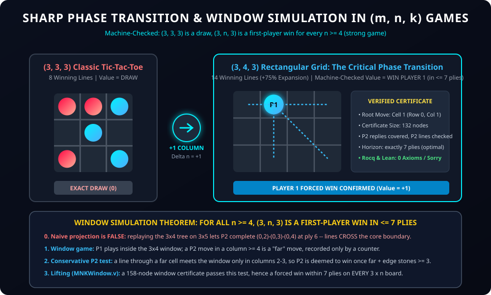

# Generalized $(m, n, k)$ Positional Games Without Gravity

[](https://rocq-prover.org/)
[](https://leanprover.github.io/)
[-success.svg)](CheckAssumptions.v)
[-success.svg)](lean4/MNKGames.lean)

Machine-checked formalization of the family of **$(m, n, k)$ games without gravity** (generalized Tic-Tac-Toe / Gomoku) in **Rocq 9.1**, with an independent **Lean 4.35.0** cross-check of the computational core and of the Erdős–Selfridge and strategy-stealing theorems. Details are in the [Mathematical Monograph](MNK_MATHEMATICAL_MONOGRAPH.md).

All game-theoretic statements are about the **strong (maker-maker) game**: players alternately claim empty cells, and the first player to own all $k$ cells of a line wins. They are stated with an explicit semantic predicate `forces_win lines p d b`: player $p$, to move on board $b$, completes a line within $d$ of its own moves against **every** legal reply, and the opponent never completes a line first. A position is a **draw** when neither player can force a win (`game_is_draw`).

---

## Main Theorem: The $(3, n, 3)$ Sharp Phase Transition



$$
\begin{aligned}
\mathrm{Value}(3, 3, 3) &= \mathrm{DRAW} \\
\mathrm{Value}(3, n, 3) &= \mathrm{WIN}_{P1} \text{ within } 7 \text{ plies}, \quad \forall n \ge 4 \\
\mathrm{Value}(3, n, 3) &= \mathrm{WIN}_{P1} \text{ in exactly } 7 \text{ plies}, \quad 4 \le n \le 21
\end{aligned}
$$

The first two lines are `mnk_3_3_3_draw` and `mnk_3_n_3_first_player_win`, packaged together as `sharp_phase_transition_3_n_3`. "Exactly 7 plies" means that no strategy wins within 5 plies. That is `mnk_3_4_3_exactly_7_plies` for $n = 4$ and `mnk_3_n_3_exactly_4_moves` for $4 \le n \le 21$ (see [Exact winning speeds](#exact-winning-speeds-and-breaker-certificates-formal)). The values themselves are classical; what is new here (to our knowledge, see [Related formal work](#related-formal-work)) is a complete machine-checked proof for **every** $n$.

### How it is proved
1. **$(3, 3, 3)$ draw.** A verified exhaustive evaluator `wins_b` (`wins_b_spec`: `wins_b = true` $\iff$ `forces_win`) shows that neither player can force a win.
2. **$(3, 4, 3)$ win.** The original 132-node certificate (opening at cell $1 = (0, 1)$) is re-checked by a **sound** checker, and `check_cert_sound` turns the check into `forces_win (gen_lines 3 4 3) P1 4`. The evaluator also proves that no forced win exists within 5 plies.
3. **All $n \ge 4$: Window Simulation Theorem** (`window_certificate_lifts`, [`MNKWindow.v`](MNKWindow.v)). Player 1 plays inside the $3 \times 4$ window. Any Player 2 move in a column $\ge 4$ is a *far* move, recorded only by a counter. A line through a far cell meets the window only in columns $2..3$, so Player 2 is conservatively deemed to have won once it owns a window line, or once $f \ge 1$ and $f + e \ge 3$. Here $f$ is the number of far moves and $e$ is the number of Player 2 stones in columns $2..3$. A 158-node certificate passes this check, and the theorem lifts it to a forced win on the empty $3 \times n$ board for every $n \ge 4$.

### Why the former "Subgrid Monotone Projection" argument was wrong
Earlier revisions claimed that cells outside the $3 \times 4$ core "intersect zero winning lines", so that Player 2's exterior moves would be harmless dummy moves. **That is false**, because lines cross the boundary of the core. Following the 132-node strategy on $3 \times 5$:

$$
P1{:}\,(0,1),\; P2{:}\,(0,3),\; P1{:}\,(0,0),\; P2{:}\,(0,2),\; P1{:}\,(1,1),\; P2{:}\,(0,4) \;\Rightarrow\; P2 \text{ owns } (0,2)\text{-}(0,3)\text{-}(0,4)
$$

Player 2 wins at ply 6, before Player 1's planned winning move. This is machine-checked as `subgrid_projection_counterexample_3_5_3` (Rocq and Lean). `projected_cert_rejected_3_5_3` shows that the embedded certificate is rejected on $3 \times 5$.

---

## Complete Characterization of the $(m, n, 3)$ Games (formal)

$$
\forall m, n \in \mathbb{N}: \quad \mathrm{Value}(m, n, 3) = \begin{cases}
\mathrm{DRAW} & \text{if } \min(m, n) \le 2 \text{ or } (m, n) = (3, 3) \\
\mathrm{WIN}_{P1} \text{ within } 7 \text{ plies} & \text{if } \min(m, n) \ge 3 \text{ and } \max(m, n) \ge 4
\end{cases}
$$

Proved as `mnk_k3_complete_characterization`:
* $\min(m, n) \le 2$: these boards **do** contain 3-in-a-row lines whenever the other side is $\ge 3$. The draw comes from a **domino pairing strategy**: pair $(r, 2j) \leftrightarrow (r, 2j{+}1)$, or the column version. Every line contains a full domino, and the opponent always answers in the partner cell (`pairing_draw`, `mnk_two_rows_draw`, `mnk_two_cols_draw`, [`MNKPairing.v`](MNKPairing.v)).
* $(m, 3, 3)$ with $m \ge 4$: $4 \times 3$ window certificate (`mnk_m_3_3_first_player_win`).
* $m, n \ge 4$: $4 \times 4$ corner-window certificate, giving a win **within 5 plies** (`mnk_m_n_3_first_player_win_5_plies`). That is exactly 5 plies: nobody completes 3 in a row in fewer than 3 own moves (`mnk_m_n_3_exactly_3_moves`).

---

## Two Classical Theorems of Positional Game Theory, Machine-Checked

Both theorems hold for **every** hypergraph, not only for $(m, n, k)$ boards, and both are proved in Rocq and independently re-proved in Lean.

### Strategy stealing (Nash): the second player never wins
`strategy_stealing` ([`MNKStrategyStealing.v`](MNKStrategyStealing.v)): for every family of winning lines and every board size, the second player has no forced win from the empty board. The proof formalizes three facts about `forces_win`:
* **Colour symmetry** (`forces_win_swap`): exchanging all stone colours exchanges the roles of the players.
* **An extra stone never hurts** (`steal`): adding a stone of your own colour either completes a line at once or keeps a forced win within the same number of moves.
* **No double wins** (`not_both`): two players cannot both force a win from the same position.

Combined with the verified evaluator, this gives a constructive dichotomy with no excluded middle (`positional_game_win_or_draw`, `mnk_value_win_or_draw`): every $(m, n, k)$ game is **either a forced first-player win or a draw**.

### The Erdős–Selfridge theorem (1973)

$$
\sum_{A \in E} 2^{-\lvert A \rvert} < \tfrac{1}{2} \;\Longrightarrow\; \text{Breaker, moving second, prevents Maker from claiming a whole edge.}
$$

`erdos_selfridge_breaker_second` ([`MNKErdosSelfridge.v`](MNKErdosSelfridge.v)) proves this for arbitrary non-uniform hypergraphs, and `erdos_selfridge_breaker_first` proves the variant where Breaker moves first, which needs only a sum below $1$. The proof is the classical potential-function argument with every weight scaled by $2^K$, so it stays in the natural numbers. A Maker move at $x$ adds exactly the weight through $x$. A greedy Breaker reply removes at least as much. A completed Maker line alone would weigh $2^K$.

In the strong game each player can play Breaker against the other, so the game is a **draw** (`erdos_selfridge_draw`). For $(m, n, k)$ boards this gives `mnk_erdos_selfridge_draw`:

$$
\mathcal{L}(m, n, k) < 2^{k-1} \;\Longrightarrow\; \mathrm{Value}(m, n, k) = \mathrm{DRAW}.
$$

### From Maker–Breaker strategies to game values
[`MNKMakerBreaker.v`](MNKMakerBreaker.v) proves three general facts. Each holds for every board and every family of winning lines, and together they turn a Breaker strategy into game values:
* **A Breaker win is a draw** (`breaker_win_draw`). Suppose Player 1, as Maker, cannot claim a line against some Breaker strategy. Then Player 2 uses that strategy to stop Player 1 in the strong game, and strategy stealing stops Player 2.
* **Longer lines are harder for Maker** (`maker_wins_refine`, `mnk_lines_refine`). If every line of one family contains a line of another, a Maker win for the first family is a Maker win for the second. Every $k'$-in-a-row contains a $k$-in-a-row when $k \le k'$, so a Breaker win for $(m, n, k)$ is a Breaker win for every $(m, n, k')$ with $k' \ge k$, and all those games are draws (`mnk_draw_longer_lines`). One draw certificate therefore covers a whole family of line lengths.
* **Pairing in the middle of the game** (`pairing_no_maker_win`). Breaker has answered every paired Maker stone with its partner. Every line either already carries a Breaker stone or contains a whole pair. Then Maker cannot win. Unlike `pairing_draw`, lines Breaker has already blocked need no pair, so the rule applies at any position reached in play; it is the pairing leaf of a draw certificate.
* **Smaller and transposed boards** (`maker_wins_simulate`). A Maker win carries over along any injective map of the cells that sends every line onto a line. Maker plays through the map; a Breaker reply outside its image is answered in the imagined game by a Breaker stone on some free cell, which only makes that game harder for Maker. The $m' \times n'$ board embeds in the $m \times n$ board when $m' \le m$ and $n' \le n$, and every board embeds in its transpose. So a single Breaker win settles a whole family (`mnk_breaker_win_family`):

$$
\text{Breaker wins } (m, n, k) \;\Longrightarrow\; \mathrm{Value}(m', n', k') = \mathrm{DRAW} \quad \text{whenever } m' \times n' \text{ fits inside } m \times n \text{ (either way round) and } k' \ge k.
$$

---

## The Hales–Jewett Law: Nine in a Row Is Never Forced (formal)

$$
\forall m, n \in \mathbb{N},\; \forall k \ge 9: \quad \mathrm{Value}(m, n, k) = \mathrm{DRAW}.
$$

`mnk_hales_jewett_draw` ([`MNKHalesJewett.v`](MNKHalesJewett.v)) formalizes this classical pairing result, usually credited to Hales and Jewett (1963), for every board size at once. The proof is a single pairing of the plane with period 8. Dominoes in the four line directions tile the plane so that every row, column, diagonal and anti-diagonal carries exactly one domino of its own direction in every 8 consecutive cells. Any 9 consecutive cells of a line therefore contain a whole domino, and the opponent answers every move on its partner cell:

```text
H< H> V^ V^ V^ V^ V^ V^      H< H>  horizontal domino
H< H> Vv Vv Vv Vv Vv Vv      V^ Vv  vertical domino
H< H> A^ A^ A^ D^ D^ D^      D^ Dv  diagonal domino (down-right)
Dv Av Av Av H< H> Dv Dv      A^ Av  anti-diagonal domino (down-left)
V^ V^ D^ A^ H< H> D^ A^
Vv Vv Av Dv H< H> Av Dv
H< H> A^ A^ A^ D^ D^ D^
Dv Av Av Av H< H> Dv Dv
```

The tile was found by an exact-cover search ([`solver/hales_jewett_tile.py`](solver/hales_jewett_tile.py)). In Rocq, its properties are checked by computation over one period (`hj_tile_consistent`, `hj_tile_lines`) and lifted to every board by arithmetic modulo 8. On a finite board, a cell whose partner falls off the edge stays unpaired; no line of the board needs it. The same pairing makes Breaker win the Maker–Breaker game on every board with $k \ge 9$, whoever moves first (`mnk_hales_jewett_breaker_wins`).

---

## Maker–Breaker Wins and the Gap with the Strong Game (formal)

[`MNKMakerBreakerCert.v`](MNKMakerBreakerCert.v) is a sound checker for Maker–Breaker wins (`check_mb_sound` proves `maker_wins`). A certificate gives Maker's move at each node, and one sub-certificate per Breaker reply that leaves Maker no cell completing a line. Every other reply is settled by the checker itself, so after a Maker threat only the blocking reply is listed. The certificates are generated by [`solver/mb_win_cert.c`](solver/mb_win_cert.c), which finds the fastest win and, among the fastest, the strategy with the fewest certificate nodes. They are checked in [`MNKMakerWins.v`](MNKMakerWins.v). Both wins are optimal in speed: Breaker certificates rule out any faster win (`mnk_3_3_3_mb_exactly_4_moves`, `mnk_5_5_4_mb_exactly_5_moves`, see below).

| Board | Maker–Breaker | Certificate | Strong game |
| :--- | :--- | ---: | :--- |
| $(3, 3, 3)$ | Maker wins in exactly 4 moves (`mnk_3_3_3_maker_wins`) | 17 nodes | DRAW (formal) |
| $(5, 5, 4)$ | Maker wins in exactly 5 moves (`mnk_5_5_4_maker_wins`) | 1,993 nodes | DRAW (known; not formal here) |

* **The gap** (`mnk_tic_tac_toe_gap`): tic-tac-toe is a draw, yet Maker wins its Maker–Breaker version. Player 2 survives only by making threats of its own, so no Breaker strategy alone can hold it. The same holds for $(5, 5, 4)$ (`mnk_5_5_4_no_breaker_win`): its known draw can never be proved by `breaker_win_draw`.
* **Families** (`mnk_maker_wins_k3_family`, `mnk_maker_wins_k4_family`): by the embedding and refinement theorems, Maker wins the Maker–Breaker game on every board with $m, n \ge 3$ and $k \le 3$, and on every board with $m, n \ge 5$ and $k \le 4$.

---

## Exact Winning Speeds and Breaker Certificates (formal)

A winning strategy is **optimal in speed** when it wins within $d$ own moves and no strategy wins within $d - 1$. The upper bound is a checked winning strategy. The lower bound needs a strategy for the defender, and [`MNKBreakerCert.v`](MNKBreakerCert.v) is a sound checker for those (`check_br_sound`). A certificate is a Breaker strategy tree. At each node Maker is to move, and the node lists one Breaker reply for every Maker move. Leaves are positions the checker settles by computation:

* **Erdős–Selfridge**: the potential test of `erdos_selfridge_potential`, applied to the position reached;
* **pairing**: disjoint pairs of free cells such that every open line contains a whole pair (`pairing_no_maker_win`);
* **too slow**: every open line lacks more Maker stones than Maker has moves left (`short_no_win`). This leaf is allowed only when the certificate carries a move bound.

With the bound `Some d`, an accepted certificate proves that Maker cannot win within $d$ moves; with `None`, that Maker never wins. A Maker–Breaker lower bound is also a strong-game lower bound, because a forced win in the strong game is a Maker win. The certificates are generated by [`solver/breaker_cert.c`](solver/breaker_cert.c), which minimizes their size, and checked in [`MNKExactSpeed.v`](MNKExactSpeed.v) and [`MNKBreakerDraws.v`](MNKBreakerDraws.v).

| Result | Upper bound | Lower bound | Theorem |
| :--- | :--- | :--- | :--- |
| $(m, n, 3)$, $m, n \ge 4$: exactly 3 moves (5 plies) | window certificate | no k in a row in fewer than k moves | `mnk_m_n_3_exactly_3_moves` |
| $(3, n, 3)$, $4 \le n \le 21$: exactly 4 moves (7 plies) | window certificate | 18 certificates, 133 to 3,907 positions | `mnk_3_n_3_exactly_4_moves` |
| Maker–Breaker $(3, 3, 3)$: exactly 4 moves | 17 nodes | 73 positions | `mnk_3_3_3_mb_exactly_4_moves` |
| Maker–Breaker $(5, 5, 4)$: exactly 5 moves | 1,993 nodes | 601 positions | `mnk_5_5_4_mb_exactly_5_moves` |

The $(m, n, 3)$ and $(3, n, 3)$ speeds hold in the Maker–Breaker game too (`mnk_m_n_3_mb_exactly_3_moves`, `mnk_3_n_3_mb_exactly_4_moves`). The general lower bound `mnk_no_forced_win_before_k` needs no certificate: from the empty board, no player completes $k$ in a row in fewer than $k$ own moves.

**Draws from Breaker wins.** A 381-position certificate (21 nodes, 170 Erdős–Selfridge leaves, 190 pairing leaves) proves that Breaker wins the Maker–Breaker game on $5 \times 4$ with 4 in a row. It is checked in 0.25 s (`mnk_5_4_4_breaker_wins`). So $(5, 4, 4)$ is a draw (`mnk_5_4_4_draw`). With the embedding theorems, **every board that fits inside $5 \times 4$, either way round, with $k \ge 4$ is a draw** (`mnk_draw_inside_5_4`).

The search with these three leaf rules does not finish $(6, 4, 4)$ or $(6, 6, 5)$: the table passes 3 GB. The prover settles them at once because it also splits the board into independent components and combines pairing with Erdős–Selfridge. Those rules need their own Rocq lemmas before they can appear in certificates.

---

## Prime Dimensions and the Erdős–Selfridge Criterion

Primality and coprimality of $m, n$ play **no role** in any of the arguments. (An earlier revision claimed that $\gcd(m, n) = 1$ prevents rectangular tilings of the board, which is false: $1 \times n$ strips tile every board.)

| Game | $\mathcal{L}$ | $2^{k-1}$ | Status |
| :--- | ---: | ---: | :--- |
| $(7, 5, 3)$ | 76 | 4 | $\mathrm{WIN}_{P1}$ within 5 plies: formal (since $m, n \ge 4$) |
| $(11, 7, 5)$ | 124 | 16 | value not determined here (criterion does not apply) |
| $(13, 11, 7)$ | 212 | 64 | value not determined here (criterion does not apply) |
| $(11, 7, 7)$ | 56 | 64 | $\mathrm{DRAW}$: formal (`mnk_prime_triple_11_7_7_draw`, Rocq and Lean) |
| $(17, 13, 11)$ | 184 | 1024 | $\mathrm{DRAW}$: formal (`mnk_prime_triple_17_13_11_draw`, Rocq and Lean) |
| $(19, 17, 13)$ | 284 | 4096 | $\mathrm{DRAW}$: formal (`mnk_prime_triple_19_17_13_draw`, Rocq and Lean) |

### The prime-triple law, corrected
For consecutive primes $p < q < r$ with $p \ge 7$, there are two primes in $(p, 2p)$ (Ramanujan, 1919: the second Ramanujan prime is $11$), so $r < 2p$. Note that this does **not** follow from Bertrand's postulate, which an earlier revision cited, and that it fails for $(3, 5, 7)$ and $(5, 7, 11)$. For every board with $k \le m < 2k$ and $k \le n < 2k$:

$$
\mathcal{L}(m, n, k) \le 6k^2 - 2k < 6k^2 < 2^{k-1} \qquad (k \ge 11),
$$

machine-checked universally as `erdos_selfridge_hypothesis_near_square`. With the formal Erdős–Selfridge theorem this gives `mnk_near_square_draw`: **every** board with $11 \le k \le m, n < 2k$ is a draw. Hence every game $(r, q, p)$ on a consecutive prime triple with $p \ge 11$ is a draw. Only Ramanujan's number-theoretic input $r < 2p$ is cited.

For square boards with $k$ in a row, $\mathcal{L}(k, k, k) = 2k + 2$, and the whole family is now classified (`mnk_square_classification`): **for every $k \ge 1$, the $(k, k, k)$ game is a draw if and only if $k \ge 3$.**
* $k = 1, 2$: first-player wins, in 1 and 3 plies (`mnk_1_1_1_first_player_win`, `mnk_2_2_2_first_player_win`).
* $k = 3$: the verified evaluator (`mnk_3_3_3_draw`).
* $k = 4$: here $\mathcal{L} = 10 \ge 2^3$, so the simple criterion fails. The refined form `erdos_selfridge_draw_refined` asks instead that the total weight plus the weight of any single cell stay below $2^k$. Every cell of the $4 \times 4$ board lies on at most 3 lines, and $10 + 3 = 13 < 16$, so the game is a draw (`mnk_4_4_4_draw`, Rocq and Lean).
* $k \ge 5$: $2k + 2 < 2^{k-1}$ (`mnk_square_k_draw`).

---

## Universal Line Counting and the Handshaking Identity (formal)

The generator `gen_lines m n k`, written $G(m, n, k)$ below, explicitly lists the horizontal, vertical, diagonal and anti-diagonal lines, and is characterized by `in_gen_lines`. For **all** $m, n, k$:

$$
\lvert G(m, n, k) \rvert = \mathcal{L}(m, n, k), \qquad \mathcal{L}(m, n, k) = m(n - k + 1) + n(m - k + 1) + 2(m - k + 1)(n - k + 1) \quad (k \le \min(m, n))
$$

$$
\sum_{x = 0}^{mn - 1} \deg(x) = k \cdot \mathcal{L}(m, n, k)
$$

These are `gen_lines_count` and `mnk_handshaking`. Every generated line has exactly $k$ distinct in-grid cells (`gen_lines_uniform`, `gen_lines_nodup`, `gen_lines_in_range`).

Landmark line counts (formal): $(3,3,3){:}\ 8$, $(3,4,3){:}\ 14$, $(4,4,4){:}\ 10$, $(5,4,4){:}\ 17$, $(6,4,4){:}\ 24$, $(7,4,4){:}\ 31$, $(8,4,4){:}\ 38$, $(5,5,4){:}\ 28$, $(8,8,5){:}\ 96$, $(15,15,5){:}\ 572$. The values $(4,4,4) = \mathrm{DRAW}$ and $(5,4,4) = \mathrm{DRAW}$ are now formal (see above). No strong-game value is claimed for $(6,4,4)$, $(7,4,4)$, $(8,4,4)$, $(5,5,4)$, $(8,8,5)$ or $(15,15,5)$. Under Maker–Breaker rules, $(5,5,4)$ is a formal Maker win (see above).

---

## Errata: Corrections in This Revision

| # | Previous claim / code | Problem | Fix |
| :- | :--- | :--- | :--- |
| 1 | `check_p1_cert` | Ignored Player 2's own lines; accepted `Branch m []` on a filled board (a draw) | Sound checker `check_cert` + soundness theorem `check_cert_sound` |
| 2 | `win_3_4_3_certified` | Only "a boolean function returns `true`"; no game semantics | Inductive `forces_win`; the certificate now **proves** `forces_win` |
| 3 | `sharp_phase_transition_3_n_3` | Proved only `L(3,n,3) >= 14 /\ depth <= 7`, nothing about play | Now: (3,3,3) draw $\wedge$ $\forall n \ge 4$, forced win within 7 plies |
| 4 | "Subgrid Monotone Projection" | False: boundary-crossing lines (counterexample above) | Window Simulation Theorem with a conservative far-move rule |
| 5 | `mnk_line_count_formula_closed` called "universal line counting" | Only unfolds a definition | `gen_lines_count` against an explicit generator |
| 6 | Handshaking identity "proved" | Never formalized | `mnk_handshaking` |
| 7 | "$\mathrm{Value}(3,3,3) = \mathrm{DRAW}$" | Never formalized | `mnk_3_3_3_draw` |
| 8 | Erdős–Selfridge "machine-checked draws" | Only the inequality was checked | The Erdős–Selfridge theorem itself is now formalized, so the draws are formal |
| 9 | "Bertrand $\Rightarrow p_{i+2} < 2p_i$", "$\mathcal{L} < 4p_i^2$" | False citation / unjustified step | Ramanujan-prime citation; $\mathcal{L} < 6k^2$ proved |
| 10 | "$\min(m,n) \le 2$: DRAW (No 3-lines)" | Wrong reason; never formalized | Pairing-strategy proofs |
| 11 | "$\gcd(m,n) = 1$ $\Rightarrow$ no rectangular tiling" | False | Removed |
| 12 | $(6,4,4)$, $(7,4,4)$, $(8,4,4)$ labelled DRAW | Never verified | Labels removed |

---

## Formal Proof Architecture

```text
mnk-games/
├── _CoqProject                       # Rocq library mapping (-Q . MNK)
├── MNKBoard.v                        # Coordinates, verified line generator, counting, handshaking, E-S arithmetic
├── MNKGame.v                         # Board ops, monotonicity, forces_win semantics, verified evaluator
├── MNKCertChecker.v                  # Sound certificate checker + soundness theorem
├── MNKWindow.v                       # Window Simulation Theorem (lifting window certificates)
├── MNKPairing.v                      # Pairing strategies; draws for min(m, n) <= 2
├── MNKPhaseTransition.v              # Certificates, (3,3,3) draw, (3,n,3) transition, (m,n,3) characterization
├── MNKErdosSelfridge.v               # Erdős–Selfridge theorem (Maker–Breaker), strong-game draws, (k,k,k) classification
├── MNKStrategyStealing.v             # Strategy stealing: the second player never wins; win-or-draw dichotomy
├── MNKMakerBreaker.v                 # Breaker win => draw; monotonicity in k; mid-game pairing; embeddings
├── MNKHalesJewett.v                  # Hales–Jewett: every (m, n, k) game with k >= 9 is a draw
├── MNKMakerBreakerCert.v             # Sound checker for Maker–Breaker win certificates
├── MNKMakerWinCerts.v                # Generated Maker–Breaker win certificates (solver/mb_win_cert.c)
├── MNKMakerWins.v                    # Checked Maker wins: (3,3,3), (5,5,4); the gap; families
├── MNKBreakerCert.v                  # Sound checker for Breaker strategies (bounded or not); no k in a row before k moves
├── MNKBreakerCerts.v                 # Generated Breaker certificates (solver/breaker_cert.c)
├── MNKExactSpeed.v                   # Exact winning speeds: (m,n,3), (3,n,3), Maker–Breaker (3,3,3) and (5,5,4)
├── MNKBreakerDraws.v                 # (5,4,4) Breaker win; every board inside 5 x 4 with k >= 4 is a draw
├── CheckAssumptions.v                # Strict audit (166 theorems closed, 0 axioms)
├── build.ps1                         # Rocq 9.1 build + audit (counts every Print Assumptions)
├── lean4/
│   ├── lakefile.toml                 # Lake project definition
│   ├── lean-toolchain                # Lean 4.35.0 toolchain
│   └── MNKGames.lean                 # 63 audited Lean theorems: checker soundness, certificates, E-S, strategy stealing
├── build_lean.ps1                    # Lean 4 compilation and axiom auditor
├── solver/
│   ├── mnk_solver.c                  # 64-bit bitboard negamax engine with transposition table
│   ├── audit_mnk.c                   # 6-pass numerical harness (lines, handshaking, values, E-S, horizons, counterexample)
│   ├── mb_win_cert.c                 # Maker–Breaker win certificate generator (Rocq output)
│   ├── breaker_cert.c                # Breaker certificate generator: speed lower bounds and draws (Rocq output)
│   └── hales_jewett_tile.py          # Finds and brute-force checks the Hales–Jewett tile
├── assets/
│   └── mnk_phase_transition.svg      # Illustration of the phase transition and the window argument
├── MNK_MATHEMATICAL_MONOGRAPH.md     # Mathematical treatise
└── README.md                         # This file
```

The Lean file independently re-checks every certificate and the counterexample, and proves the soundness of its own checker. It also re-proves the Erdős–Selfridge theorem, the three prime-dimension draws and strategy stealing. The lifting theorem, the (3,3,3) draw, the pairing draws, the characterization, the universal $(m, n, k)$ corollaries, the Maker–Breaker transfer theorems, the Hales–Jewett draw, the Maker–Breaker and Breaker certificates and the exact speeds are proved in Rocq only.

---

## Verification & Reproduction

### 1. Compile the Rocq 9.1 proof
```powershell
powershell -ExecutionPolicy Bypass -File .\build.ps1
```
```text
=== Compiling Generalized (m, n, k) Games Formal Mathematical Proof in Rocq 9.1 ===
Compiling MNKBoard.v... OK (2.28s)
Compiling MNKGame.v... OK (0.61s)
Compiling MNKCertChecker.v... OK (0.43s)
Compiling MNKWindow.v... OK (0.75s)
Compiling MNKPairing.v... OK (0.68s)
Compiling MNKPhaseTransition.v... OK (22.37s)
Compiling MNKErdosSelfridge.v... OK (0.66s)
Compiling MNKStrategyStealing.v... OK (0.56s)
Compiling MNKMakerBreaker.v... OK (0.72s)
Compiling MNKHalesJewett.v... OK (0.87s)
Compiling MNKMakerBreakerCert.v... OK (0.46s)
Compiling MNKMakerWinCerts.v... OK (0.66s)
Compiling MNKMakerWins.v... OK (3.34s)
Compiling MNKBreakerCert.v... OK (0.6s)
Compiling MNKBreakerCerts.v... OK (4.35s)
Compiling MNKExactSpeed.v... OK (27.8s)
Compiling MNKBreakerDraws.v... OK (0.99s)
Compiling CheckAssumptions.v... OK (15.87s)
...
SUCCESS: 166/166 theorems closed under global context (0 axioms, 0 admits)!
```

### 2. Compile the Lean 4.35.0 cross-check
```powershell
powershell -ExecutionPolicy Bypass -File .\build_lean.ps1
```
```text
Axiom dependency report (63 theorems audited, 35 use only standard axioms):
SUCCESS: 63 Lean 4 theorems verified with 0 sorry and 0 custom axioms (11.32s)!
```

### 3. Run the C verification harness
```powershell
gcc -O3 -Wall -Wextra solver\audit_mnk.c -o solver\audit_mnk.exe
.\solver\audit_mnk.exe
```
```text
[PASS 1] Verifying Universal Line Counting Formula L(m, n, k)... 16/16 [OK]
[PASS 2] Verifying Hypergraph Handshaking Identity: Sum deg(c) = k * L... 7/7 [OK]
[PASS 3] Verifying Exact Game-Theoretic Values via Negamax Engine...
  (3, 3, 3): DRAW, (3, 4, 3): WIN FOR PLAYER 1, (4, 4, 4): DRAW, (5, 4, 4): DRAW [OK]
[PASS 4] Verifying the Erdos-Selfridge hypothesis L < 2^(k-1)... 3/3 [OK]
[PASS 5] Verifying exact forced-win horizons in the strong game...
  (3, n, 3) for n = 4..8 and (m, 3, 3) for m = 4..6: exactly 7 plies; (4,4,3), (4,5,3), (5,5,3): 5 plies [OK]
[PASS 6] Replaying the refuted subgrid-projection line on 3 x 5... [OK]
ALL AUDIT PASSES COMPLETED WITH ZERO ERRORS!
```

---

## Related Formal Work

A search of the Archive of Formal Proofs (Isabelle), Lean's Mathlib and Reservoir package index, the Rocq package index, the Lean community chat archives and arXiv (November 2026) found **no earlier machine-checked development of general $(m, n, k)$ games**, **no proof-assistant proof that tic-tac-toe is a draw**, and **no formalization of the Erdős–Selfridge game theorem or of strategy stealing**. A search cannot prove absence, so these are "to our knowledge" statements. The closest work we found:

* **Tic-tac-toe in Lean 4** ([aochagavia/tic-tac-toe](https://reservoir.lean-lang.org/@aochagavia/tic-tac-toe)): defines the game and proves basic facts, such as that a drawn game ends on a full board with no winning line. It does not prove that the game is a draw.
* **Game trees in Rocq** ([bloomberg/game-trees](https://github.com/bloomberg/game-trees)): verified game-tree unfolding, with tic-tac-toe used only as a minimax example.
* **Hales–Jewett** in Mathlib and in the AFP (Isabelle): the colouring theorem behind high-dimensional tic-tac-toe, without its game consequence. The planar pairing draw for $k \ge 9$ (section above) is a different, game-theoretic result, and is formal here.
* **Hypergraph Colouring Bounds** (AFP, 2023, Edmonds and Paulson): probabilistic-method colouring bounds for hypergraphs. The Erdős–Selfridge potential argument is the game-theoretic, derandomized cousin of such bounds.
* Concurrent 2026 strong-game results on grids with Lean proofs: **transversal achievement game** ([arXiv:2608.13501](https://arxiv.org/abs/2608.13501)) and **square achievement game** ([arXiv:2610.22410](https://arxiv.org/abs/2610.22410)). The latter extends one checked board to all larger boards by a simulation theorem, in the same spirit as our Window Simulation Theorem. Also a Lean proof that Maker wins the **Snaky** hexomino Maker–Breaker game on the infinite board within 21 moves ([openai/math](https://github.com/openai/math)).

---

## Cross-Branch Navigation

* Master Theory Hub & Portal: [`main`](https://github.com/TACITVS/Theorem_Prover_Formalization_of_Board_Games/tree/main)
* 8x8 English Checkers: [`checkers`](https://github.com/TACITVS/Theorem_Prover_Formalization_of_Board_Games/tree/checkers)
* Connect-5 (8x8 Grid): [`connect5-8x8`](https://github.com/TACITVS/Theorem_Prover_Formalization_of_Board_Games/tree/connect5-8x8)
* Connect-5 (8x7 Grid): [`connect5-8x7`](https://github.com/TACITVS/Theorem_Prover_Formalization_of_Board_Games/tree/connect5-8x7)
* Dots and Boxes (5x5 / 16 Box): [`dots-and-boxes`](https://github.com/TACITVS/Theorem_Prover_Formalization_of_Board_Games/tree/dots-and-boxes)
* Nine Men's Morris: [`nine-mens-morris`](https://github.com/TACITVS/Theorem_Prover_Formalization_of_Board_Games/tree/nine-mens-morris)
* Twelve Men's Morris: [`twelve-mens-morris`](https://github.com/TACITVS/Theorem_Prover_Formalization_of_Board_Games/tree/twelve-mens-morris)
* Generalized (m, n, k) Positional Games: [`mnk-games`](https://github.com/TACITVS/Theorem_Prover_Formalization_of_Board_Games/tree/mnk-games)
