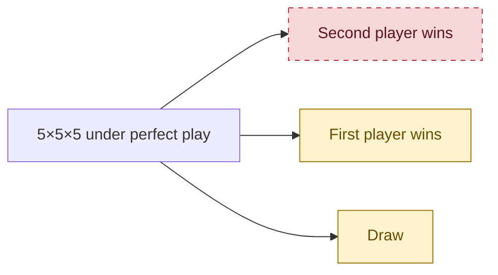
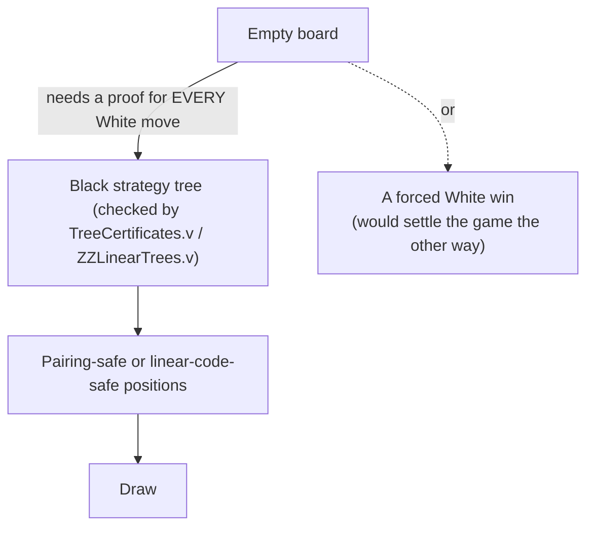

<h1 align="center">5×5×5 3D Tic-Tac-Toe</h1>

<p align="center">
  <b>A machine-checked research project on one of the smallest unsolved board games in mathematics.</b>
</p>

<p align="center">
  
  
  
  
  
</p>

<p align="center">
  <a href="research-021/README.md">Latest checked result</a> ·
  <a href="research-022/README.md">Six-opening reduction</a> ·
  <a href="QUBIC-PROOF-GATE-001/README.md">Proof gate</a> ·
  <a href="assets/view_board.html">Explore the board</a>
</p>

> [!IMPORTANT]
> **This repository does NOT prove that 5×5×5 tic-tac-toe is a draw.**
> Whether perfect play ends in a draw or a first-player win is still an **open problem**.
> Earlier versions of this page said the game was solved as a draw. That claim was **wrong**, and it has been withdrawn (see [Corrections](#-corrections)).

---

## 🎯 The answer at a glance

| Question | Answer | Status |
| :--- | :---: | :--- |
| Can the **second** player force a win? | **No** | ✅ **Proved** in Rocq (strategy stealing), no axioms or admits |
| Can the **first** player force a win? | **Unknown** | ❓ Open |
| Is it a **draw** with perfect play? | **Unknown** | ❓ Open, often conjectured, never proved |

In one sentence: **the first player can never lose, but nobody knows whether they can always win.**



<p align="center"><sub>Red dashed box: ruled out by a machine-checked proof. Yellow boxes: both still possible.</sub></p>

---

## 🧊 The game in 60 seconds

- The board is a **5 × 5 × 5 cube** of **125 cells**.
- Two players take turns. **White moves first** and **Black moves second**. Each turn, the player claims one empty cell.
- The first player to claim **5 cells in a straight line** wins. A line can run along a row, along a column, through a plane diagonal, or through a space diagonal.
- There are exactly **109 winning lines**. If the board fills up with no line completed, the game is a **draw**.

<p align="center">
  <a href="assets/qubic_5x5x5_board.svg">
    
  </a>
  <br/>
  <a href="assets/qubic_5x5x5_board.svg"><b>Full-size diagram</b></a> &nbsp;•&nbsp;
  <a href="assets/view_board.html"><b>Interactive viewer</b></a>
</p>

### Where this game sits in the family of cube games

| Board | Who wins with perfect play? | Source |
| :---: | :--- | :--- |
| 3×3×3 | First player | Classical |
| 4×4×4 (Qubic) | First player | Patashnik (1980) |
| **5×5×5** | ❓ **Unknown** | **Open** |
| 6×6×6 | ❓ Unknown | Open |
| 7×7×7 | Draw | Cain, Raymond & Källersjö (2025), [arXiv:2509.21494](https://arxiv.org/abs/2509.21494) |
| 8×8×8 and larger | Draw | Known pairing strategies (as summarized in Cain et al. 2025) |

The 2025 paper that settled 7×7×7 explicitly lists 5×5×5 and 6×6×6 as still open.

---

## 🧬 Latest checked advance: beyond fixed pairing

A fixed pairing assigns a partner to each defended cell. On a 5×5×5 board,
different winning lines share at most one cell, so a pair can protect at most
one line. A new Rocq proof uses **two disjoint sets of free cells that each
encode every surviving line**. After White moves, Black can repair the
damaged set using an XOR exchange argument.

| Checked position | Unblocked lines | Free cells | Cells fixed pairing would need | Cells in each information set |
| :--- | ---: | ---: | ---: | ---: |
| After 20 legal moves | 53 | 105 | 106 | 52 |
| After 22 legal moves | 54 | 103 | 108 | 51 |

For **each** position, Rocq proves one Black strategy prevents White from
winning against **every remaining continuation**. It also proves that no
partner function satisfies the project's static pairing invariant there.
The 22-move certificate appears in
[`StrongerWitness.v`](research-021/StrongerWitness.v), and
[`research-021/README.md`](research-021/README.md) explains the proof and its
tensor and topology calculations.

**The missing step:** a legal path to a safe position is not enough. To settle
the game, Black must force a safe position against every White strategy from
the empty board, or White must be proved to force a win. The existing Rocq
checker would accept a complete Black strategy tree at the empty board.

---

## ✅ What is actually proved

Everything below is checked by the **Rocq 9.1 kernel** with **zero axioms and zero admits** in its dependencies. The rules are fixed in a hash-pinned file, [`trusted/Rules.v`](QUBIC-PROOF-GATE-001/trusted/Rules.v).

| # | Plain-English result | Rocq theorem | File |
| :-: | :--- | :--- | :--- |
| 1 | The 109 lines in the rules file are exactly all straight lines of the cube, with no duplicates. | `locked_lines_are_exactly_standard_lines`, `locked_lines_distinct` | [`Geometry.v`](QUBIC-PROOF-GATE-001/agent/Geometry.v) |
| 2 | Every game is legal and gets the correct result. | `every_play_is_legal_and_terminal` | [`RulesFacts.v`](QUBIC-PROOF-GATE-001/agent/RulesFacts.v) |
| 3 | **The first player has a strategy that never loses.** | `white_nonloss_proved` | [`Stealing.v`](QUBIC-PROOF-GATE-001/agent/Stealing.v) |
| 4 | So the game is a draw **if and only if** the second player has a strategy that never loses. | `exact_draw_iff_black_nonloss` | [`Stealing.v`](QUBIC-PROOF-GATE-001/agent/Stealing.v) |
| 5 | Making two different winning threats at once takes at least 7 stones. | `distinct_targets_require_seven_stones` | [`Tactics.v`](QUBIC-PROOF-GATE-001/agent/Tactics.v) |
| 6 | A simple blocking strategy stops White from winning in the first 14 moves, whatever White does. | `blocking_policy_delays_white_win_until_ply_fifteen` | [`Tactics.v`](QUBIC-PROOF-GATE-001/agent/Tactics.v) |
| 7 | Once Black reaches a "pairing-safe" position, Black can never lose from there. | `static_pairing_policy_nonloss` | [`SafePairing.v`](QUBIC-PROOF-GATE-001/agent/SafePairing.v) |
| 8 | A checked strategy tree starting **from the empty board** would prove the draw. (No such tree exists yet.) | `checked_empty_tree_proves_exact_draw` | [`TreeCertificates.v`](QUBIC-PROOF-GATE-001/agent/TreeCertificates.v) |
| 9 | Pairing alone cannot work on the empty board: 62 pairs can block at most 62 of the 109 lines. | `static_pairing_impossibility_algebraic` | [`QubicAlgebraic.v`](QubicAlgebraic.v) |
| 10 | The earlier "43 pairs + 17 stones" defense **loses on move 9**. | `pairing_policy_is_not_nonlosing` | [`research-017/Regressions.v`](research-017/Regressions.v) |
| 11 | A permutation of the cube's layers reduces the ten geometric opening cases to six. After a center opening, Black needs one successful reply among five representatives. | `exact_draw_iff_six_openings`, `center_opening_iff_five_replies` | [`ZLayerSymmetry.v`](QUBIC-PROOF-GATE-001/agent/ZLayerSymmetry.v) |
| 12 | Two legal nonterminal positions have complete linear-code defenses where the static pairing invariant is impossible. | `linear_defense_strictly_beyond_pairing` | [`research-021/Witness.v`](research-021/Witness.v), [`StrongerWitness.v`](research-021/StrongerWitness.v) |
| 13 | A checked strategy tree with pairing or linear-code leaves at the empty board would prove the draw. No such tree is supplied. | `checked_empty_linear_tree_proves_exact_draw` | [`ZZLinearTrees.v`](QUBIC-PROOF-GATE-001/agent/ZZLinearTrees.v) |
| 14 | Every whole-line linear-code leaf fails at the empty board. The XOR of 19 winning lines isolates the center, which every information set must contain. | `every_whole_line_leaf_rejects_empty` | [`ZLinearObstruction.v`](QUBIC-PROOF-GATE-001/agent/ZLinearObstruction.v) |
| 15 | Regional Erdős–Selfridge certificates (pairing and potential arguments on disjoint regions, mixed freely) are sound Black non-loss leaves, include every pairing leaf, and cannot exist at the empty board because `6·109 > 5·125`. | `regional_certificate_nonloss`, `pairing_leaf_is_regional`, `empty_board_has_no_regional_certificate` | [`research-026/RegionalCertificates.v`](research-026/RegionalCertificates.v) |

<details>
<summary><b>How does result 3 work? (strategy stealing in plain words)</b></summary>

<br/>

Suppose the second player had a strategy that always wins. The first player could then make an arbitrary first move and afterwards pretend to be the second player, following that winning strategy.

An extra stone on the board can never hurt you in this game. So the first player would also win, which contradicts the assumption. The idea goes back to John Nash.

The hard part is making this airtight for the exact rules. The proof has to handle the extra stone, moves that land on the extra stone, immediate wins, full boards, and illegal move requests. [`Stealing.v`](QUBIC-PROOF-GATE-001/agent/Stealing.v) does all of this, and the kernel checks it. It does **not** search the game tree.

</details>

---

## ❌ What is NOT proved: the missing piece

Everything left comes down to a single statement:

```coq
Goal.BlackNonLossFromEmpty :=
  exists black : BlackStrategy, forall white : WhiteStrategy,
    outcome (play white black) <> WhiteWins.
```

*"The second player has a strategy that never loses."*

- If this is proved, the game is a **draw** (by result 4).
- If it is refuted, the first player has a **forced win**.

[Research 020](research-020/README.md) now proves an equivalent set of ten
full-horizon opening cases, using verified game-theoretic cube symmetries.
Applying the level permutation `[1,0,2,4,3]` on all three axes preserves every
winning line as a set. Together with rotations and reflections, this reduces
the draw question to openings at cells **0, 1, 2, 7, 12 and 62**. All six
values remain undetermined.

[Research 021](research-021/README.md) adds verified defenses using binary
linear codes and matroid exchange. Its 20- and 22-move positions have complete
Black nonloss strategies beyond the static pairing invariant. Forcing an
accepted position from the empty board against every White strategy remains
unproved.

In [`agent/Solution.v`](QUBIC-PROOF-GATE-001/agent/Solution.v) it is still marked `Admitted`. The fail-closed proof gate therefore **rejects** the exact-draw claim, as it should:

```text
$ python QUBIC-PROOF-GATE-001/tools/verify_gate.py --rocq rocq
Axioms:
black_nonloss : BlackNonLossFromEmpty
REJECTED: Axiom/assumption audit FAILED: expected 2 closed theorems, got 0.
```

> [!NOTE]
> The gate will only print `ACCEPTED` when `black_nonloss` is proved with no axioms or admits.

> [!WARNING]
> `trusted/Rules.v` and `trusted_hashes.json` were written by an AI agent, not supplied by an independent reviewer. The gate's own security design requires a human to review and pin them.
> As a partial check, `Geometry.v` proves the 109 lines are exactly the cube's straight lines. A human review of the rules file is still outstanding.

---

## 🧪 Evidence that is *not* proof

These experiments are useful for intuition. **None of them establishes the game value.**

| Experiment | What it shows | Why it is not a proof |
| :--- | :--- | :--- |
| 50,000 simulated games ([`stress_test_beck.c`](solver/stress_test_beck.c)) | A heuristic defender never lost to a heuristic attacker. | Tests one attacker model, not every possible strategy. |
| Beck "danger" score dropping below 1 at round 27 | One greedy line of play reduces a threat measure. | Holds for one sequence of moves, not for all White strategies. |
| Round-10 and Round-17 pairing positions | Some mid-game positions are pairing-safe (result 7). | Nobody has shown Black can **force** reaching such a position. |
| Z3 "UNSAT" for the 43-pair schedule | White cannot win **inside that fixed position**. | Says nothing about how to reach the position. |
| VCF threat search ([`search_vcf.c`](solver/search_vcf.c)) | No immediate four-threat chains from one opening stone. | Skips quiet setup moves; a smoke test only. |

---

## 🧭 How a real solution could look



The missing link is the top arrow. It needs a Black reply to **every** White move from the empty board until a verified safe position is reached. The pairing version of this step solved 7×7×7, where it took only 4 moves. On 5×5×5, a counting argument shows pairing cannot even start before Black's 7th move. Research 021 adds linear-code leaves that can succeed where the pairing invariant is impossible; a complete opening tree is still missing.

---

## 📐 Board geometry

<details>
<summary><b>The 109 winning lines</b></summary>

<br/>

Cells are numbered `c = x + 5·y + 25·z` with `x, y, z ∈ {0,…,4}`.

| Kind | Count | Description |
| :--- | :---: | :--- |
| Straight (axis-parallel) | 75 | 25 lines along each of the x, y, and z axes |
| Plane diagonals | 30 | 2 diagonals in each of the 15 axis-parallel planes |
| Space diagonals | 4 | Corner to opposite corner through the centre |
| **Total** | **109** | Proved in `Geometry.v` to be exactly the cube's straight lines |

Any two different lines share at most one cell (`two_lines_intersect_at_most_once`). This is why a 2-cell "pair" can only ever protect one line.

</details>

<details>
<summary><b>How many lines pass through each cell (10 symmetry classes)</b></summary>

<br/>

| Cell type | Cells | Lines through each | Example cell |
| :--- | :---: | :---: | :---: |
| Centre | 1 | **13** | 62 |
| Corners | 8 | 7 | 0 |
| Inner corners | 8 | 7 | 31 |
| Face centres | 6 | 5 | 12 |
| Inner axis cells | 6 | 5 | 37 |
| Inner plane cells | 12 | 4 | 32 |
| Edge midpoints | 12 | 4 | 2 |
| Outer flank cells | 24 | 4 | 6 |
| Edge inner cells | 24 | 4 | 1 |
| Face interior cells | 24 | 3 | 7 |
| **Total** | **125** | 545 incidences = 109 × 5 | |

</details>

---

## 🔁 Reproduce

Requires [Rocq 9.1](https://rocq-prover.org/) and Python 3.

```powershell
# The official gate (expected result today: REJECTED, because black_nonloss is unproved)
python QUBIC-PROOF-GATE-001/tools/verify_gate.py --rocq rocq

# Partial results, each compiled from scratch with assumption audits
python research-017/verify.py   # strategy stealing, geometry, rules facts
python research-018/verify.py   # pairing-safe leaves, strategy-tree checker
python research-019/verify.py   # 14-ply opening bound, forced-block and fork rules
python research-020/verify.py   # full-game symmetry and the exact ten-opening reduction
python research-021/verify.py   # linear-code defense and strict separation from pairing
python research-021/tensor_structure.py --check  # exact F2 tensor/topology calculations
python research-022/verify.py   # six opening classes and the center parity obstruction
python research-026/verify.py --rocq rocq   # regional Erdős–Selfridge barrier (seconds)

# Legacy building-block library (92 theorems, all closed)
.\build.ps1
```

---

## 🗂️ Repository map

| Path | Contents |
| :--- | :--- |
| [`QUBIC-PROOF-GATE-001/`](QUBIC-PROOF-GATE-001/) | Hash-pinned rules and goal, the agent's proof files, and the fail-closed verifier |
| [`research-017/`](research-017/README.md) | Strategy stealing: the first player cannot lose |
| [`research-018/`](research-018/README.md) | Pairing-safe leaves and the strategy-tree certificate checker |
| [`research-019/`](research-019/README.md) | Opening bound and sound tactical pruning |
| [`research-020/`](research-020/README.md) | Full-game symmetry and the ten remaining opening cases |
| [`research-021/`](research-021/README.md) | Binary-code exchange defense, a checked separation from static pairing, and tensor/topology experiments |
| [`research-022/`](research-022/README.md) | Layer symmetry, six opening classes, five center replies, and an exact whole-line code obstruction |
| [`research-026/`](research-026/README.md) | Regional Erdős–Selfridge barrier: no mix of pairing and potential arguments on disjoint regions works on the empty board (`6·109 > 5·125`); Qubic-plus-three-planes structure |
| [`research-027/`](research-027/README.md) | Research programme: certificate classes, activation depth, the blocking/threat dichotomy, and fragment codes as the precise form of the tensor/topology idea (computations only) |
| [`research-028/`](research-028/README.md) | First test of fragment codes: sound on small hypergraphs, but no earlier activation than whole-line codes along the known 5x5x5 games; 4x4x4 used as a falsification testbed (computations only) |
| `Qubic*.v`, `CheckAssumptions.v` | Legacy Rocq library: board facts, symmetry, pairing certificates |
| [`solver/`](solver/) | C, C++ and Python experiments (evidence only, see above) |
| [`QUBIC_5x5x5_MATHEMATICAL_MONOGRAPH.md`](QUBIC_5x5x5_MATHEMATICAL_MONOGRAPH.md) | Historical write-up. Contains withdrawn claims; read it with the status above in mind |

---

## 📝 Corrections

This project keeps its mistakes visible.

| Audit | Finding |
| :--- | :--- |
| [014/015](QUBIC-AUDIT-014_015_FINDINGS.md) | The capacity condition for pairing is necessary but not sufficient. The VCF solver had defects. No theorem covered the full game. |
| [016](QUBIC-AUDIT-016_FINDINGS.md) | The "43 pairs + 17 stones" defense loses to White simply filling line `0-1-2-3-4` (kernel-checked, ply 9). |
| This page | **Withdrawn:** "exact draw", "unrefutable proof", "dual independent proof of the draw", and "White can never complete any line". These were never proved for the real game from the empty board. |

---

<p align="center"><sub>MIT License • Rocq 9.1 • Branch <code>qubic-5x5x5</code></sub></p>
